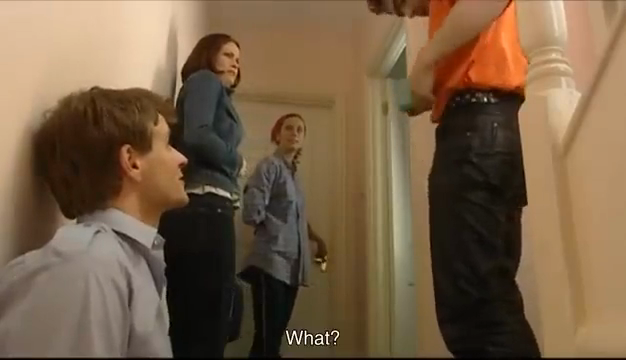
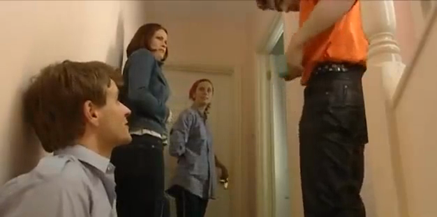
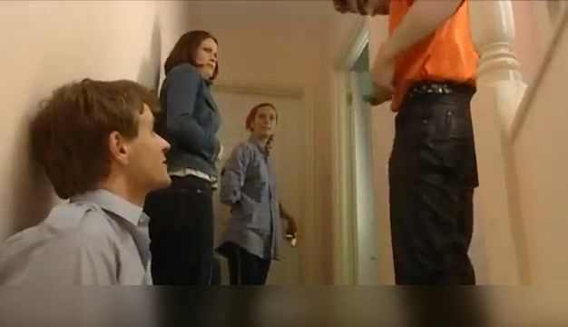
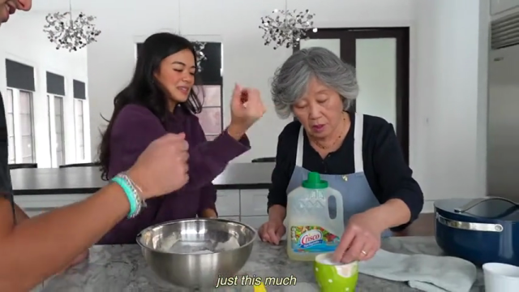
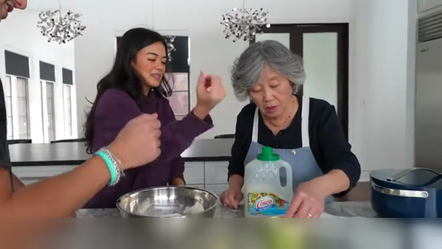
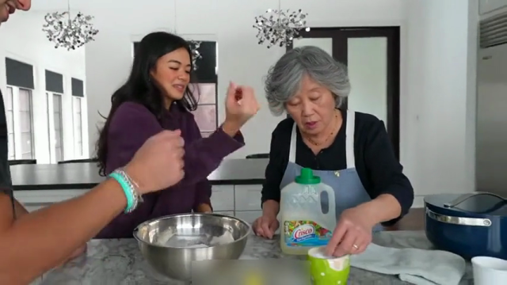
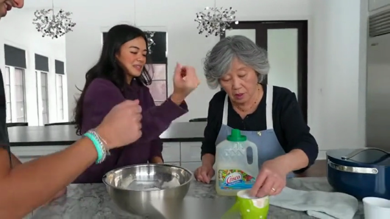
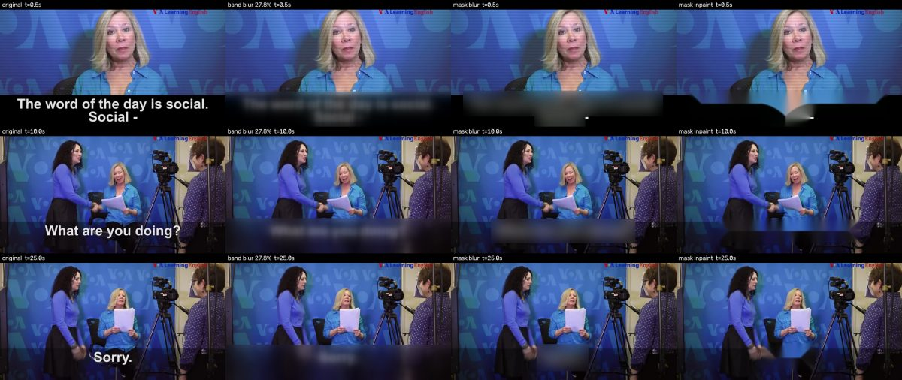
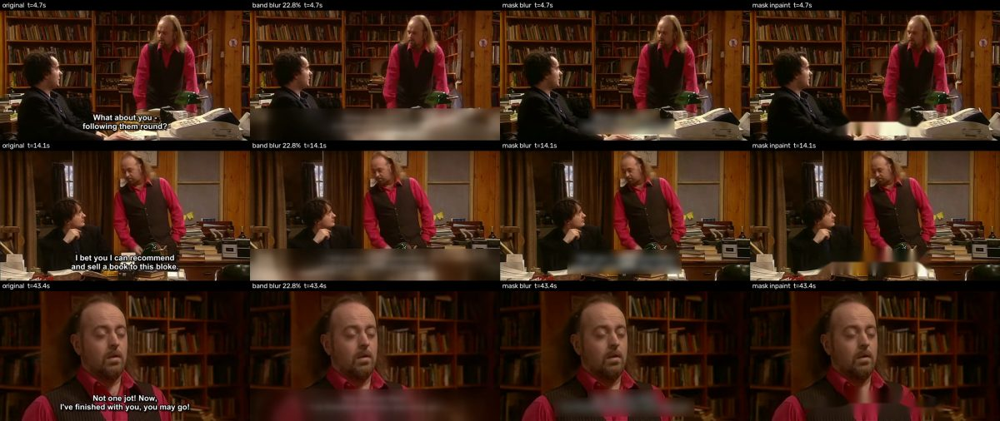

# Subtitle Band Cleaner

Detect **burned-in dialogue subtitles near the bottom of a video**, then crop, blur, or mask them in batches. The tool uses OCR to locate subtitles, copies the source audio, and exports H.264 MP4. If it detects no subtitles, it writes a JSON report without encoding a new video. Input files keep their original names and contents by default.

## Detection and file naming

For an input named `clip.mp4`, the tool writes the classification to a JSON report and uses it to name any output video. Pass `--rename-originals` to rename inputs in place without changing their contents.

| Detection result or operation | Input name by default | Input name with `--rename-originals` | Output video |
| --- | --- | --- | --- |
| No subtitles detected | Unchanged | `clip_no_subtitle.mp4` | None |
| Subtitles detected, crop | Unchanged | `clip_with_subtitle.mp4` | `clip_subtitle_cropped.mp4` |
| Subtitles detected, blur | Unchanged | `clip_with_subtitle.mp4` | `clip_subtitle_blurred.mp4` |
| Subtitles detected, mask | Unchanged | `clip_with_subtitle.mp4` | `clip_subtitle_masked.mp4` |

Output videos and reports omit any existing `_no_subtitle` or `_with_subtitle` suffix from the input name. For example, `clip_with_subtitle.mp4` still produces `clip_subtitle_cropped.mp4`. Batch processing skips files already ending in `_subtitle_cropped`, `_subtitle_blurred`, or `_subtitle_masked`. When renaming an original, the tool keeps its extension, avoids duplicate suffixes, and reports a naming conflict without replacing either file. If a video fails to decode or process, the batch continues with the other videos and exits with a nonzero status.

## Frame comparison

The images show the same frame at **9.5 seconds** before and after processing. The tool detected a band covering the bottom **13.3%** of the frame. Crop removes that band; blur obscures the subtitle while keeping the full frame. All images are shown at the same width and retain their aspect ratios.

| Original | Automatic crop | Automatic blur |
| --- | --- | --- |
|  |  |  |
| 626 × 360 | 626 × 312 | 626 × 360 |

## Mask mode: edit only the subtitle boxes

`crop` and `blur` operate on a fixed bottom band throughout the video. That band may contain useful details, such as hands or objects on a table. `--mode mask` edits only the rectangles around detected subtitles. Frames without active boxes go straight to the encoder without masking. `--margin-pixels` expands each rectangle on all sides. Choose a fill with `--mask-fill`: `blur` (default, Gaussian blur), `pixelate` (mosaic), or `inpaint` (OpenCV's Telea method via `cv2.inpaint`).

Mask mode uses the same `detect_bottom_band` step as crop and blur. It runs when subtitles are detected or when you pass `--force-process --bottom-percent`. In the first pass, OCR samples only the bottom band, at 5 samples per second by default (`--mask-fps`). The tool keeps changing text boxes that match a detected subtitle track's baseline and horizontal position, and filters out static text. Between sampled frames, it combines boxes from adjacent samples. It can keep a box for another `--mask-hold` samples after the text disappears (default: 3) to reduce flicker. In the second pass, PyAV decodes, masks, and encodes each frame using its original presentation timestamp, while copying audio packets from the source.

RapidOCR normally scales up images with a short side below 736 pixels, which can make OCR on a narrow band slower than OCR on a full frame. Mask mode uses a separate detector that limits the long side to 960 pixels. The initial subtitle detection step uses the same detector as before. In a local CPU test of a 70-second clip at 854 × 480 and 30 fps, each band sample took about 30 ms. OCR took about 10 seconds for 350 samples, and the full masking run took about 34 seconds. Running OCR on every full frame would take about 5 minutes at the measured rate.

Here is a different clip, OmniTalk R8-15 (854 × 480), at 36 seconds. Full-band blur affects the bottom 12.5% of the frame, including the bowl and hands. Mask mode targets the subtitle boxes.

| Original | Full-band blur | Mask with blur | Mask with inpainting |
| --- | --- | --- | --- |
|  |  |  |  |

## Installation

Requires Python 3.10 or later. If FFmpeg is not on your PATH, `imageio-ffmpeg` provides an executable. A system FFmpeg must support `-fps_mode passthrough` and `-enc_time_base:v filter` (version 7.1 or later is recommended). OCR uses [RapidOCR](https://rapidai.github.io/RapidOCRDocs/main/en/install_usage/rapidocr/install/) and ONNX Runtime. The OCR models come with the Python package.

```bash
python3 -m venv .venv
.venv/bin/pip install -r requirements.txt
```

## Usage

Detect subtitles and crop one video:

```bash
.venv/bin/python clean_subtitles.py input.mp4 outputs --mode crop
```

Process a directory with full-band blur, keeping the full composition:

```bash
.venv/bin/python clean_subtitles.py videos outputs --mode blur
```

Mask only the subtitle boxes. In this example, inpainting fills the boxes instead of blurring them:

```bash
.venv/bin/python clean_subtitles.py videos outputs --mode mask --mask-fill inpaint
```

Detect and write a JSON report for each video without creating any new videos or modifying the originals:

```bash
.venv/bin/python clean_subtitles.py videos outputs --classify-only
```

Detect and rename originals according to the result:

```bash
.venv/bin/python clean_subtitles.py videos outputs --classify-only --rename-originals
```

Set the bottom band height manually as a percentage. This option alone does not process videos in which no subtitles were detected:

```bash
.venv/bin/python clean_subtitles.py input.mp4 outputs --mode crop --bottom-percent 15
```

The JSON report records the classification, original file path (or new path if renamed), whether the video was processed, the number of text candidate frames, the subtitle band, and the subtitle track positions. Mask mode also reports its fill, sample rate, sample count, and number of masked frames. For a clip without detected subtitles, the report is named `clip_no_subtitle.json`.

Initial detection samples about one frame per second, up to 600 frames per video. Use `--sample-interval` and `--max-samples` to change this. Use `--margin-pixels` to add space above the subtitle band or around each box in mask mode. Pass `--overwrite` to replace an existing output.

The default detector looks for at least 3 distinct captions at the same position to help distinguish dialogue subtitles from logos, name captions, and signs. For short clips with only one or two captions, lower the threshold. For subtitles outside the center, expand the detection area:

```bash
.venv/bin/python clean_subtitles.py input.mp4 outputs --min-distinct-captions 1 --alignment any
```

If you have confirmed that subtitles are present but OCR misses them, force processing and specify the band height:

```bash
.venv/bin/python clean_subtitles.py input.mp4 outputs --force-process --bottom-percent 15
```

## Export quality and audio sync

The default output is H.264 MP4 at `--crf 16` with Lanczos scaling. After subtitle processing, frames taller than 480 pixels are scaled proportionally to a height of 480 pixels. Smaller frames are never upscaled. For example, a 360p input stays at 360p with blur or mask, while crop produces a shorter frame. H.264 with 4:2:0 chroma subsampling requires even dimensions. Odd dimensions may lose one pixel, and downscaled widths are rounded to an even value close to the original aspect ratio. Pass `--max-height 0` to disable the height limit.

Edited video is re-encoded, so pixels outside the masked region can change, and downscaling to 480p reduces fine detail. All three modes preserve the source frame timestamps and copy audio tracks that MP4 supports. Any audio and video offset already present in the source carries over. When no subtitles are detected, the tool writes only a JSON report and leaves the source resolution and content intact.

## How detection works and what it can miss

OCR considers text near the bottom of the frame, centered by default. The detector checks for a consistent baseline and horizontal position, and for text that changes over time. It merges small OCR spelling variations and considers multiple lines together. Crop and blur use a fixed boundary derived from a low percentile of the detected subtitle positions, so the band is processed even when subtitles disappear. Crop removes the bottom part of the frame and changes the aspect ratio. Blur keeps the composition but obscures the band. Mask limits edits to subtitle boxes, but can miss brief captions if OCR fails across consecutive samples. Adjacent samples and `--mask-hold` help cover shorter gaps. Text outside the band is not masked.

`no_subtitle` means the sampled frames did not contain matching bottom dialogue subtitles. It does not rule out all on-screen text. Sparse, brief, unusually styled, or differently positioned subtitles may go undetected. Changing on-screen banners can be mistaken for subtitles. OCR does not detect separate subtitle tracks, which are omitted from newly encoded outputs. The source file and its tracks remain intact when no subtitles are detected.

## Validation

```bash
python -m unittest discover -s tests -v
```

The suite covers file naming and conflicts, subtitle track detection, mask boxes, and export. The export tests encode variable frame rate clips at 360p, 480p, and 720p and check output height, video frame timestamps, and audio packet timestamps and hashes for all three modes.

### Export quality and timing

On 2026-11-13, we exported a real 360p dialogue clip and a 720p test copy in all three modes (Apple Silicon, FFmpeg 7.1, PyAV 19.0.2, CRF 16). For audio sync, we also used a variable frame rate clip with three flash-and-beep pairs. Luma PSNR compares the top 60% of the output with reference frames cropped and scaled the same way without re-encoding.

| Input | Output size: crop / blur / mask | Luma PSNR, top of frame | Audio and video timing |
| --- | --- | --- | --- |
| Dialogue, 626 × 360 | 626 × 312 / 626 × 360 / 626 × 360 | 49.7–49.9 dB | All 570 frame timestamps and audio packets matched the source |
| Dialogue test copy, 1252 × 720 | 950 × 480 / 834 × 480 / 834 × 480 | 48.8–49.2 dB | All 570 frame timestamps and audio packets matched the source |
| Variable frame rate, 1280 × 720, with a 366 ms starting offset | 1004 × 480 / 854 × 480 / 854 × 480 | — | All 165 frame timestamps and audio packets matched; no added offset at any of the 3 sync points |

Mask mode edited 432 of 570 frames in each dialogue test. These results apply to the tested clips. PSNR excludes the edited subtitle region and does not measure detail lost by scaling from 720p to 480p.

### Classification

On 2026-10-21, we used the default settings: roughly one sampled frame per second, up to 600 frames per video, with at least 3 distinct captions at the same position. The new sample folder had 9 entries across 6 distinct filenames; we tested one of each alongside 5 previously supplied videos with subtitles. At that time, renaming originals was the default, equivalent to passing `--rename-originals` now.

| Sample group | Clips | Classification | SHA-256 unchanged after renaming | Output videos |
| --- | ---: | --- | --- | --- |
| No dialogue subtitles; some clips include name captions, logos, or scene text | 6 | All 6: `no_subtitle` | 6/6 | 0 |
| Bottom dialogue subtitles | 5 | All 5: `with_subtitle` | 5/5 | 5 cropped outputs; blur also tested on 1 clip |

These results describe the sample batch, not detection accuracy across all subtitle styles.

### Masking performance

On 2026-10-23, before the export update, we tested the R8-15 clip shown above (854 × 480, 30 fps, 70 seconds) on a local CPU with default settings and `--preset medium`. The source hash was unchanged across runs. All four output videos were 70.000 seconds long and kept the source audio track.

| Mode | Time, including about 14 seconds of detection | Frames edited |
| --- | ---: | ---: |
| `crop` | 18.6 s | All |
| `blur` | 20.0 s | All |
| `mask --mask-fill blur` | 33.7 s | 666 / 2100 |
| `mask --mask-fill inpaint` | 35.7 s | 666 / 2100 |

For mask mode, the frame count refers to frames where a subtitle mask was applied. Unmasked frames matched a plain re-encode pixel for pixel in that test. Full-frame OCR on every other frame of the three masked clips found no readable subtitles on unmasked frames.

On the same day, we tested two more subtitle styles with the default settings and `--preset medium`. The VOA Learning English clip (640 × 360, 25 fps, 26 seconds) has large white subtitles, sometimes with a second line below the usual baseline. The Black Books clip (640 × 360, 25 fps, 62 seconds) has small white two-line subtitles over a desk full of books. Both fills masked the same number of frames. Full-frame OCR checked every other frame. A one-second subtitle, “Sorry.”, initially escaped masking in the VOA clip because its box was taller than the 16% detection limit. Once the masking pass allowed boxes up to 20% of frame height, the OCR check found no remaining readable subtitles in either clip. Areas of the bottom band without subtitle boxes were left unmasked.

| Clip | Detection | `blur` | Mask: blur / inpaint | Frames masked |
| --- | --- | ---: | ---: | ---: |
| VOA (26 s) | Bottom 27.8%; 7 distinct captions | 6.4 s | 18.8 / 27.5 s | 615 / 650 |
| Black Books (62 s) | Bottom 22.8%; 14 distinct captions | 14.8 s | 30.8 / 36.8 s | 1004 / 1549 |

Each row shows the same moment: original, full-band blur, mask with blur, and mask with inpainting.





The repository includes the comparison images. Full source and output videos are kept outside Git.
