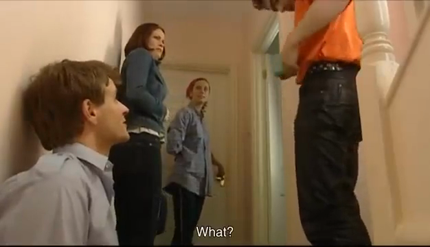
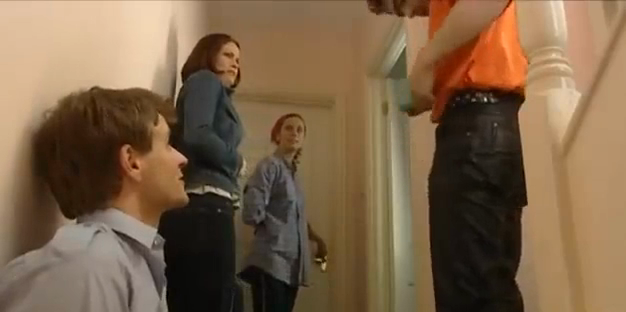
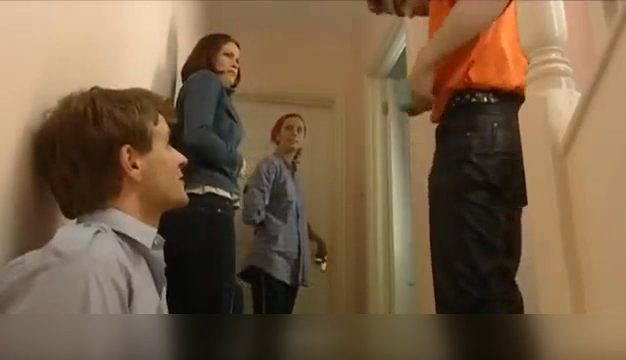
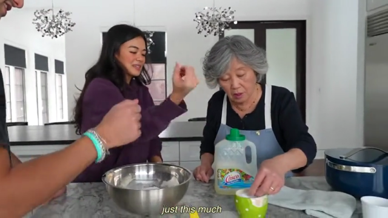
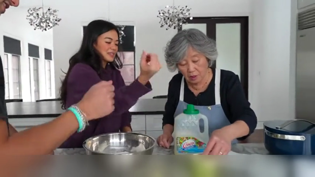
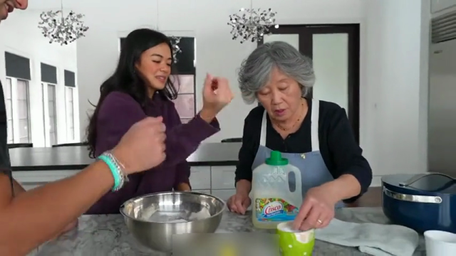
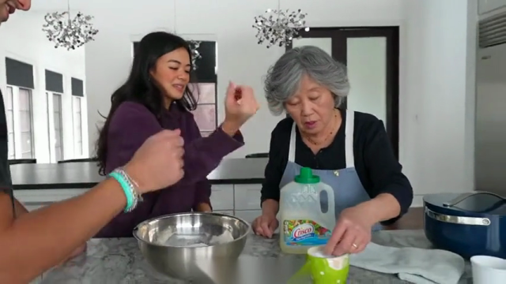
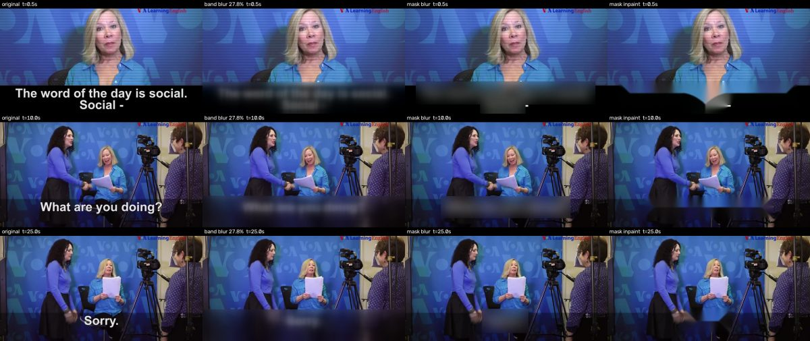
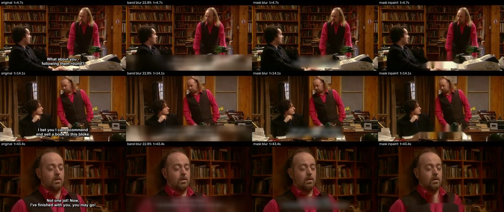

# Subtitle Band Cleaner

先检测视频是否有**烧进画面、位于底部**的对白字幕，再批量裁剪、模糊或逐帧遮盖。有字幕时，工具根据 OCR 自动估计字幕区域，保留音轨并输出 H.264 MP4；没有检出字幕时，只在输出目录写一份 JSON 检测记录，不重新编码，也不生成处理后的视频。输入视频默认不会被重命名或改动。

## 检测与命名

输入 `clip.mp4` 时，命名规则如下。**原视频默认保持原名和内容不变**，检测结果写入输出目录的 JSON 记录和成片文件名；加 `--rename-originals` 时，原视频会在输入目录中按检测结果重命名，文件内容不变。

| 检测结果 / 操作 | 输入目录中的原视频 | 加 `--rename-originals` 时 | 输出目录中的成片 |
| --- | --- | --- | --- |
| 未检出字幕 | 不改动 | `clip_no_subtitle.mp4` | 不生成 |
| 有字幕，裁剪 | 不改动 | `clip_with_subtitle.mp4` | `clip_subtitle_cropped.mp4` |
| 有字幕，模糊 | 不改动 | `clip_with_subtitle.mp4` | `clip_subtitle_blurred.mp4` |
| 有字幕，遮盖 | 不改动 | `clip_with_subtitle.mp4` | `clip_subtitle_masked.mp4` |

成片和 JSON 记录的文件名会去掉输入已有的 `_no_subtitle` 或 `_with_subtitle` 后缀，例如 `clip_with_subtitle.mp4` 仍输出 `clip_subtitle_cropped.mp4`；批处理会跳过 `_subtitle_cropped`、`_subtitle_blurred` 和 `_subtitle_masked` 成片。使用 `--rename-originals` 时，原视频保留原扩展名，已有后缀不会重复添加；若重命名将覆盖另一个原视频，工具会报错并保留两个原文件。单个视频解码或处理失败时会继续检查同批次的其他视频，并以非零状态退出。

## 单帧效果对比

以下是同一段视频在 **9.5 秒**处的原始帧与实际处理结果。工具自动检测到需处理底部 **13.3%**：裁剪模式移除该区域，模糊模式保留原始尺寸并遮挡字幕。图片按相同宽度展示，保留各自的高宽比。

| 原始帧 | 自动裁剪 | 自动模糊 |
| --- | --- | --- |
|  |  |  |
| 626 × 360 | 626 × 312 | 626 × 360 |

## 逐帧遮盖（mask 模式）

`crop` 和 `blur` 对整段视频处理一条固定高度的底部横带。当这条横带里有观众需要看到的内容，例如桌上的手和器物，就会连同字幕一起丢掉。`--mode mask` 只处理 OCR 找到的字幕文字框：每帧只遮盖字幕所在的矩形，没有字幕的帧原样写出，画面尺寸和横带其余部分都保留。字幕框会按 `--margin-pixels` 向四周外扩，填充方式由 `--mask-fill` 决定：`blur`（默认，只对文字框做高斯模糊）、`pixelate`（马赛克）或 `inpaint`（`cv2.inpaint` Telea 修补，视觉上最干净）。

检测步骤和 `crop`、`blur` 相同，仍由 `detect_bottom_band` 判断有无字幕并给出横带和字幕轨道位置；只有检出字幕（或 `--force-process --bottom-percent`）才进入遮盖。遮盖分两遍：第一遍只对横带裁剪区域做 OCR，默认每秒 5 个样本（`--mask-fps`），只保留与已接受的字幕轨道基线和水平位置一致、且随时间变化的文字框，固定文字沿用检测阶段的轨道逻辑剔除；两个样本之间的帧沿用上一个样本的框并合并下一个样本的框，文字消失后再保留 `--mask-hold`（默认 3）个样本，避免遮盖闪烁。第二遍逐帧解码、填充，再把原始帧通过管道交给 FFmpeg 编码，音轨直接从源文件复制。

计算量：RapidOCR 默认把短边不足 736 像素的图放大后再检测，对窄长的横带裁剪反而比整帧更慢；遮盖模式单独使用一个把长边限制在 960 像素的检测器实例，检测阶段的引擎和结果不变。在本机 CPU 上，854 × 480、30 fps、70 秒的片段，每个横带样本约 30 ms，全片 350 个样本的 OCR 约 10 秒，整个遮盖流程约 34 秒；逐帧整帧 OCR 则需要约 5 分钟。

以下是另一段视频（854 × 480，OmniTalk 片段 R8-15，36 秒处）的对比，不是上表那段视频；横带模糊按工具自动检出的底部 12.5% 处理。横带模糊把碗和双手一起糊掉，逐帧遮盖只盖住字幕：

| 原始帧 | 整条横带模糊 | 逐帧遮盖（blur） | 逐帧遮盖（inpaint） |
| --- | --- | --- | --- |
|  |  |  |  |

## 安装

需要 Python 3.10+。系统没有 `ffmpeg` 时，`imageio-ffmpeg` 会提供可执行文件。OCR 使用 [RapidOCR](https://rapidai.github.io/RapidOCRDocs/main/en/install_usage/rapidocr/install/) 和 ONNX Runtime，模型随 Python 包安装。

```bash
python3 -m venv .venv
.venv/bin/pip install -r requirements.txt
```

## 使用

自动检测并处理一个视频：

```bash
.venv/bin/python clean_subtitles.py input.mp4 outputs --mode crop
```

自动处理整个文件夹；`blur` 保持原始画面尺寸：

```bash
.venv/bin/python clean_subtitles.py videos outputs --mode blur
```

只遮盖字幕文字框，保留横带里的其他画面；`--mask-fill inpaint` 用修补代替模糊：

```bash
.venv/bin/python clean_subtitles.py videos outputs --mode mask --mask-fill inpaint
```

只检测并为每个视频写 JSON 检测记录，不生成裁剪或模糊成片，也不改动原视频：

```bash
.venv/bin/python clean_subtitles.py videos outputs --classify-only
```

同时按检测结果重命名所有原视频：

```bash
.venv/bin/python clean_subtitles.py videos outputs --classify-only --rename-originals
```

已检出字幕时，可手动指定底部高度；这个参数本身不会让无字幕视频进入处理分支：

```bash
.venv/bin/python clean_subtitles.py input.mp4 outputs --mode crop --bottom-percent 15
```

每个视频在输出目录都有一份 JSON 检测记录，包括分类结果、原视频路径（重命名时为新文件名）、是否检出字幕、是否处理、候选文字帧数、字幕区域和字幕轨道位置；遮盖模式另记录填充方式、采样率、样本数和被遮盖的帧数。无字幕的视频对应 `clip_no_subtitle.json`。默认每秒抽一帧，最多 600 帧；可通过 `--sample-interval` 和 `--max-samples` 调整。`--margin-pixels` 增大字幕上方的安全边距，遮盖模式下也是文字框向四周外扩的像素数。默认不覆盖已有成片；再次处理时加 `--overwrite`。

默认要求同一字幕位置至少出现 3 种不同文字，以减少把台标、固定人物介绍和场景标牌误判为对白字幕。仅有一两句字幕的短视频可降低阈值；非居中字幕可扩大检测范围：

```bash
.venv/bin/python clean_subtitles.py input.mp4 outputs --min-distinct-captions 1 --alignment any
```

如果已经人工确认有字幕，但 OCR 未检出，可明确强制处理并给出高度：

```bash
.venv/bin/python clean_subtitles.py input.mp4 outputs --force-process --bottom-percent 15
```

## 原理与边界

OCR 只把画面下方、默认居中的文本视为字幕候选，检查其底线和水平位置是否稳定、文字是否随时间更换；微小 OCR 拼写差异会合并。多行字幕会一起纳入。最终使用低分位位置确定一条整段视频固定的裁剪线，因此字幕出现或消失时，处理区域仍然存在。`crop` 会改变画面高宽比并丢掉底部画面；`blur` 保留尺寸，但被模糊的区域不能复原。`mask` 只改动字幕文字框，但依赖逐样本 OCR：某个样本漏检时，相邻样本的框和 `--mask-hold` 能补上短暂的遗漏，连续多个样本都漏检的短字幕仍可能有零点几秒未被遮盖；横带以外的文字不会被遮盖。遮盖模式把解码后的原始帧按源视频的平均帧率送入 FFmpeg，源视频流的起始时间和像素宽高比由 `ffprobe`（若可用）读出并重新写入；可变帧率的源视频会被当作恒定帧率处理，画面与音轨可能错位，这类视频请用 `crop` 或 `blur`。

`no_subtitle` 表示抽样中未检出符合条件的底部对白字幕，并非逐帧证明完全没有文字。很稀疏、短暂、特殊样式或其他位置的字幕可能漏检；变化的节目横幅也可能被误认。仅有独立字幕轨的视频不在本工具的画面 OCR 检测范围内。进入处理分支时，独立字幕轨会从输出中移除；无字幕分支不会改动任何视频字节或轨道。

## 验证

```bash
python -m unittest discover -s tests -v
```

测试覆盖无字幕不调用编码器、默认保持原视频文件名和内容不变、同名 JSON 记录不互相覆盖、`--rename-originals` 重命名前后内容哈希一致、三种处理后缀、重复运行、原文件名冲突、解码失败和批处理继续执行，固定文字与变化字幕的区分，以及遮盖模式的文字框筛选（含多行字幕和大字号）、样本间保持、三种填充只改动框内像素、FFmpeg 命令，和用假解码器与假编码器跑通的整条遮盖流程（两遍解码帧数不一致时报错而不输出截断的视频）。

2026-10-21 本地样本验证使用默认参数：约每秒抽一帧、每视频最多 600 帧、同一位置至少 3 种不同字幕。新增文件夹按 6 个不同文件名取样（共 9 个文件条目），并与此前 5 段有字幕视频一起测试。当时工具默认重命名原视频，相当于现在加 `--rename-originals`。

| 样本组 | 数量 | 检测结果 | 原视频改名后 SHA-256 | 生成成片 |
| --- | ---: | --- | --- | --- |
| 新增无对白字幕视频，含人物介绍、台标和场景文字 | 6 | 6 段均为 `no_subtitle` | 6/6 一致 | 0 |
| 原有底部对白字幕视频 | 5 | 5 段均为 `with_subtitle` | 5/5 一致 | 5 个 `subtitle_cropped`，另对其中 1 段验证 `subtitle_blurred` |

结果只说明本批样本的行为符合预期，不代表所有字幕样式的识别准确率。

2026-10-23 在上面对比图所用的 R8-15 片段（854 × 480，30 fps，70 秒）上验证遮盖模式，默认参数，`--preset medium`，本机 CPU。输入文件在所有运行后哈希不变；四种成片都是 70.000 秒、带原音轨。

| 模式 | 耗时（含约 14 秒检测） | 被遮盖的帧 |
| --- | ---: | ---: |
| `crop` | 18.6 秒 | 全部 |
| `blur` | 20.0 秒 | 全部 |
| `mask --mask-fill blur` | 33.7 秒 | 666 / 2100 |
| `mask --mask-fill inpaint` | 35.7 秒 | 666 / 2100 |

"被遮盖的帧"是画面上有字幕、因而被改动的帧数；其余帧与直接重编码的结果逐像素相同。对三段遮盖成片隔帧做整帧 OCR 复查，未被改动的帧里读不出任何字幕。

同日再用两段字幕样式不同的片段验证遮盖模式（默认参数，`--preset medium`；两种填充的遮盖帧数相同）。VOA Learning English 片段（640 × 360，25 fps，26 秒）是大号白色字幕，有时两行且第二行挂在单行字幕基线之下；Black Books 片段（640 × 360，25 fps，62 秒）是小号白色双行字幕，字幕下方是堆满书的桌面。每段都以整帧 OCR 逐隔帧复查遮盖成片：VOA 中 1 秒钟的短字幕 "Sorry." 因文字框高度超过检测阶段的 16% 上限而漏遮，遮盖阶段的上限放宽到 20% 后两段均无残留字幕；横带中没有字幕时画面原样保留。

| 片段 | 检测 | `blur` | `mask` blur / inpaint | 被遮盖的帧 |
| --- | --- | ---: | ---: | ---: |
| VOA（26 秒） | 底部 27.8%，7 种字幕 | 6.4 秒 | 18.8 / 27.5 秒 | 615 / 650 |
| Black Books（62 秒） | 底部 22.8%，14 种字幕 | 14.8 秒 | 30.8 / 36.8 秒 | 1004 / 1549 |

两段的三个字幕时刻对比（每行从左到右：原始帧、整条横带模糊、逐帧遮盖 blur、逐帧遮盖 inpaint）：





完整的原始视频和处理后视频不会提交到 Git 仓库；仓库仅包含上面的单帧对比图。
